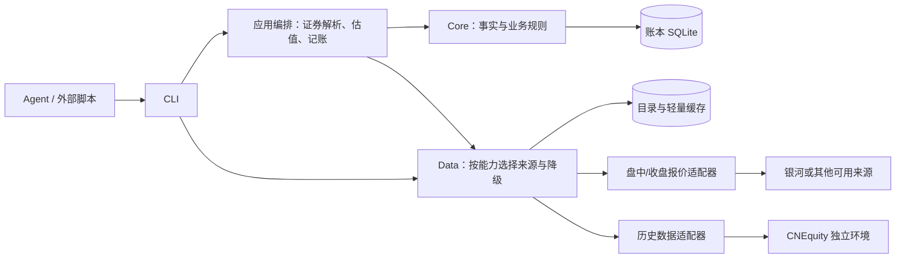

# F001：数据服务实施方案

日期：2026-11-19。状态：已按实施前澄清修订并完成首期代码实现，实际验证进度见[执行记录](执行计划.md)。

依据：[产品设计基线 v0.2](../产品设计基线-261116-v0.2.md)及[实施前澄清记录](实施前澄清记录.md)。MVP 分析基点为 `origin/main@7edbbf2e59c32c7c7cd29ba19d1b1c12d1748d2c`。

## 1. 首期目标与已确定的取舍

首期直接支持**盘中按需估值**：用户在交易时段多次查询账户或策略运行，能够看到行情及资产变化。采用行情快照，允许短暂缓存，目标约 1–5 分钟的变化粒度；不要求秒级推送、后台持续采集或盘中曲线。价格实际时间、来源和降级情况必须可见。

期初及持仓交接采用简单流程：**用户记录事实，系统自动取价计量，一次入账并回显结果供核对。** 不要求用户填写估值，不增加独立预览文件或二次确认。

核心取舍：

1. **先开发，按能力验证实际链路。** 不设置跨 3 个交易日观察、全部质量试验通过等开工门槛。必要的供应商依赖优先试通，具体功能不可用时降级。
2. **数据源可插拔、可替换。** 盘中报价、收盘价、证券资料、日历、历史日线分别选择来源，按实际验证情况确定优先级；新增来源不应改写 Core 业务规则。
3. **银河账号是可选依赖。** 不把它设为整个产品的使用前提，也不承诺首发一定能在无账号条件下自动取价。需要银河能力时先验证连接、权限和读取；无法提供则降级相应功能。
4. **CNEquity 优先用于历史能力试用。** 不作为首期盘中估值的前置依赖，不因其历史能力尚未验证而阻塞其他来源和业务开发。
5. **事实账本保持独立。** 市值随行情变化，现金、数量、成本和成交事实不随行情刷新而改变。数据源失败不阻止合法记账。

技术结构、命令和字段为实现设计；数据源实际能力尚待接入时验证，不能把下面的规划描述当成已实现或已实连结果。

## 2. 交付范围与用户路径

| 优先级 | 能力 | 边界 |
| --- | --- | --- |
| P0 首期 | 证券查询、盘中快照、账户及运行当前估值、旧价降级、期初/交接自动计量并回显 | 沪深主板股票和沪深 ETF，人民币、现金多头账本；盘中变化粒度约 1–5 分钟 |
| P1 后续 | 按标的查询历史未复权日线、按需补齐和导出 | 优先复用 CNEquity；不默认同步全市场，不阻塞 P0 |
| 按需扩展 | 更多报价来源、分钟线或更高刷新频率 | 由实际策略使用需求驱动，复用数据源接口 |
| P2 后续 | 精确复权、财务、历史成分股、时点数据及量化框架适配 | 不属于 F001 首期交付 |

不在本期扩展北交所、港美股、衍生品或融资融券。数据源覆盖范围可以大于 Core 当前可记账范围，不能因源端有数据就默认支持相关交易规则。

本期也不建设 Web UI、完整绩效分析、策略执行器、通用调度、消息投递或策略版本可选化。已有运行状态名称不在本期顺便改名。

首个使用闭环：

1. 用户通过现有 CLI/Agent 记录真实持仓及成交。
2. 查询账户或运行估值时，系统读取账本当前状态，按证券去重请求盘中快照；同证券的多个运行共用报价。
3. 返回现金、持仓市值、资产总额和价格时间；行情失败时明确显示缓存价/收盘价降级，缺价时给出未估值持仓。
4. 盘前/盘后记录期初或交接事实时，系统按对应收盘价计量并回显，数量和历史账本成本保持连续。
5. 没有可用价格时事实仍可入账，估值标为待确定，后续通过系统取价补齐。

## 3. MVP 继承与重构

| 当前实现 | 继承内容 | 调整方向 |
| --- | --- | --- |
| [Ledger](../../src/strathive/core/ledger.py)、[replay](../../src/strathive/core/replay.py)、[rules](../../src/strathive/core/rules.py) | 事务内重算、资产归属、历史更正、Decimal、交接成本连续 | 当前估值放到应用编排，不混入账本事实重放；期初/交接只增加自动计量与最少来源信息 |
| [schema](../../src/strathive/adapters/schema.py) | 账本证券引用、期初价格、交接记录 | 保留历史引用，支持系统取得的价格和待估值状态；旧手工估值数据按原值读取，不强制重新取价 |
| [Catalog](../../src/strathive/adapters/catalog.py) | 独立目录 SQLite、同步锁、旧数据可用、品种冲突保护 | 迁入 Data 参考资料模块，增加来源/获取时间；不因单次响应缺条目就停用证券 |
| `Ledger.instrument()`、`Ledger._instrument()`、[bootstrap](../../src/strathive/bootstrap.py) | 精确解析及首次入账证券快照 | 目录解析移到应用编排；Core 消费已解析身份，补录优先本账本引用，历史查询保持离线 |
| [sources](../../src/strathive/sources/sync.py)、[worker](../../src/strathive/sources/worker.py)、[galaxy](../../src/strathive/sources/galaxy.py) | SDK 子进程隔离、超时、网络在写事务外、失败保留旧目录 | 将目录专用适配拆为具体能力，增加行情读取；不能把证券目录读取成功当成报价权限已具备 |
| [settings](../../src/strathive/settings.py)、[setup](../../src/strathive/cli/setup.py) | 原子配置、凭据权限、安装引导 | 从单一 `source=galaxy/public` 改为按用途选择来源；行情未配置不影响账本和目录 |
| [schedule](../../src/strathive/schedule.py) | 既有每日 09:15 目录刷新 | 保留目录任务；盘中先按查询刷新，不引入行情守护进程 |
| [CLI](../../src/strathive/cli/__init__.py)、[输入说明](../../skills/strathive-ledger/references/inputs.md) | JSON、错误码、请求 ID、复合事务 | 增加 Data/估值命令，更新 Skill；Data 查询不要求存在账本 |

内部模块、接口可以直接重构。兼容工作优先保护已有账本、业务事实、已提交请求结果和可恢复性，不为内部 Python 类的历史形状增加转发层。

## 4. 可替换的数据源结构



拟议结构：

```text
src/strathive/
  core/                  # 账本规则、事务、事实与已采用的边界计量
  application/           # 证券解析、当前估值、记账时自动计量
  data/
    models.py            # 证券、价格、日历、批量结果
    service.py           # 能力路由、短缓存、主备及旧价降级
    reference.py         # 证券目录与同步
    cache.py             # 少量行情缓存
    providers/           # 按统一能力接口实现的具体数据源
      public.py
      galaxy.py
      cnequity.py
  adapters/              # 账本 SQLite、迁移、业务文件输入
  cli/
  bootstrap.py           # Core 与 Data 分别装配
```

Data 面向调用者提供有限的具体能力：

```python
data.instruments(queries)
data.quotes(symbols, refresh=False, offline=False)
data.close_prices(symbols, session_date)
data.calendar(market, start, end)
# 后续增加：
data.daily_bars(symbols, start, end, adjustment="none")
```

每个适配器只实现自身支持的能力，可独立替换；不同来源无需被迫实现所有方法。来源配置使用 `reference/quote/close/calendar/daily` 等实际用途，每类有独立的有序来源列表，适配器声明支持的市场及品种。明确返回不支持、缺价、认证失败或超时，调用层无需识别供应商异常。

采用显式装配和小接口即可，不先建设动态插件发现、通用能力注册平台或统一金融查询语言。新增盘中报价来源的主要工作应集中在适配器、配置与契约样本，Core 和估值计算保持不变。

Core 不导入 SDK、CNEquity、pandas 或 HTTP；Data 不认识账户 ID、不读取账本。`--holdings` 等便利入口由应用层从账本取标的，再调用 Data。供应商原生依赖继续隔离在受控进程中。

## 5. 按能力接通来源

| 数据用途 | 首期处理 |
| --- | --- |
| 证券资料 | 继承已配置的银河/公开目录，后续可接其他来源 |
| 盘中快照 | 优先接通能实际读取的链路；需要银河时先核实 SDK、账号权限和一次报价读取。无可用来源时按约定降级，不宣称已提供盘中变化 |
| 收盘价 | 按实际可用性选择银河或其他来源，用于边界计量和普通查询降级；不要求先建立完整历史库 |
| 日历 | 复用可用来源及本地缓存；覆盖未知时不能以普通工作日代替交易日 |
| 历史日线 | 优先试用 CNEquity，独立推进，不进入首期盘中链路的关键路径 |

必要链路验证以“环境可加载、连接可用、权限足够、返回能转换成所需数据”为目标，随开发进行。无需先完成全市场质量证明、固定天数观察或全套研究矩阵。

主来源失败后可以尝试已配置的备用来源；不同市场、品种可以选择不同来源优先级。不跨源拼接一根 K 线的 OHLCV，不以基金净值或复权价替代市场成交价。仅查询报价不会触发安装后端或全量同步。

CNEquity 的事实核验见[调研与验证计划](CNEquity调研与验证计划.md)。接入时继续采用独立 Python 环境及有界的短进程调用，复用它的历史存储和查询接口，不直接写内部表或复制全库。显式处理基金开关、代码映射、单位和复权默认行为。默认初始化可能抓全市场历史，不能用于首期报价初始化。

CNEquity 的完整试验矩阵是后续排查和增强材料，不再是 F001 开发或盘中报价上线的整包前置条件。数据许可与代码许可分别记录，不把开源代码许可解释为行情可随包再分发。

## 6. 最少数据语义与运行时处理

| 对象 | 必须明确的语义 |
| --- | --- |
| 证券 | 保留 `SH.600000`、`SZ.159915` 标识；市场、品种、币种；供应商代码在适配器内转换 |
| 价格 | 证券、价格、币种、`last/close` 类型、是否复权、价格时间/交易日、获取时间、来源；源版本可得时记录 |
| 数量与金额 | 股票为股、ETF 为份，成交额为元；价格与金额以十进制字符串传输，内部使用 Decimal |
| 日历 | 市场、日期、是否交易、覆盖范围与来源；范围外为未知 |
| 批量结果 | 成功项、缺失项、逐项原因、实际使用的来源及降级情况 |

源端提供报价时间就保留；只提供获取时间时如实标注时间精度未知，不伪装成交易所逐笔时间。日线仅有日期时标为交易日收盘口径；`retrieved_at` 不能替代价格发生时间。

不建设强制质量审查流程。实现仍需做消费数据所必需的基本处理，例如标的映射、单位转换、拒绝不可解析或非有限价格，避免明显无效值进入计算。波动异常等只需给出提示，不先引入复杂拦截；没有数据只表示缺失，不能推断停牌或自动清零。

当前查询分别表达覆盖和时效：`availability=complete/partial/unavailable`，`freshness=current/stale/unknown`，并附降级原因。源端时间未知时不能仅靠刚抓取就标成新鲜。约 1–5 分钟是体验目标，不是所有来源的实时 SLA。

## 7. 盘中按需估值

### 7.1 获取及降级

默认查询可请求联网快照，短缓存减少重复请求。正常情况下使用盘中报价，缓存初始可按约 1 分钟配置；`--refresh` 跳过短缓存，`--offline` 仅使用已有数据。具体刷新参数在适配器实连后调整，不要求用户先手工同步才能看盘中变化。

统一降级顺序：

1. 可用的盘中主源或备用源。
2. 已有缓存报价，显示实际价格时间及读取失败原因。
3. 最近可用的已完成交易日收盘价，明确显示“按收盘价估算”。
4. 完全无价时保留现金、持仓数量和缺价项，相关总资产返回空。

休市期间使用最近收盘价不冒充盘中报价；当日收盘价未取得时保留实际日期。缓存使用和旧价降级不改变价格时间，不能通过刷新获取时间制造行情变化。

### 7.2 计算与账本一致性

应用层在短读事务中取得账户与各运行的现金、数量、成本及状态，关闭事务后取价。记录输入状态摘要；返回前如发现相关状态已改变，可重读并计算一次，仍冲突则返回可重试结果。摘要不能只依赖最大事件 ID，因为现有成交更正会修改旧行。网络请求不持有账本锁。

计算：持仓市值为数量乘价格，运行总资产为现金加持仓市值，账户总资产等于未分配现金加各运行总资产。同证券共用同一次报价，内部保留 Decimal 精度；展示到分时集中处理舍入尾差，保证账户与运行汇总一致。

有持仓缺价时，`total_assets=null`，单独给出现金、已定价市值和未定价持仓；价格齐全但含旧价时可返回总额，并标明旧价来源。纯现金账户不需要行情。`cash_occupied` 继续表示成本，不改作市值。

这是“当前账本持仓 × 当前可用价格”的参考资产，不是任意历史时点净资产或完整收益率。若账本包含未来生效事实，须明确返回当前估值不能直接使用该投影，不能把未来数量当成现在持仓。

## 8. 期初及交接：顺带计量，不增加流程

用户录入现金、数量、成本及生效时间，系统自动计算市值并随记账结果回显。保留账本成本与市场价值两个不同口径，不要求用户输入 `valuation_price`，不增加估值文件、独立预览、二次确认或价格审批。

处理规则：

- 期初/交接按盘前或盘后的业务边界处理，沿用现有生效时间表达，不引入预约或调度系统。
- 盘前使用上一已完成交易日收盘价，盘后使用当日收盘价；非交易日使用最近已完成交易日收盘价。历史生效时间须取对应日期的价格，不能用今日价代替。
- 在账本写事务外取得价格，事务内按实际数量和原有一致性规则完成记账。取价失败不丢失事实，返回成功记账及“待估值”项；不能用成本或不匹配日期的旧价填成正式起点。
- 回显事实输入、所用价格及日期、算得市值和待估值项，供用户核对。交接双方使用同一份价格，账户数量与历史成本不因交接估值变化。
- 自动采用的单价、来源、价格日期随相关业务记录保存，支持离线解释；不依赖临时缓存 ID。以后普通行情刷新不会改写它。
- 缺价后提供轻量补齐用例：系统按原生效日期取得价格，只补空缺计量并回显结果，事实和已采用价格保持原值。同一交接记录补齐后同时用于旧运行期末与新运行期初。

期初可在原有价格字段旁增加可空的来源/日期元数据，交接在现有价格对象内扩展；不为此建设独立估值审批或证据管理子系统。旧数据缺少来源/时间时保持未知，不联网猜填。

关键写入继续使用请求 ID：按用户提交的事实输入判定重试，系统自动取得的报价不应让同一请求重试产生不同指纹。已提交请求直接返回原结果，不重新取价；后续补齐估值是单独用例。历史成交更正继续重放归属与数量，采用原来保存的单价，不能自动重取价格改变计量基准。

首期不扩展完整绩效分析，也不顺带建设通用的期初/交接撤销与历史重做系统。基础事实修正仍须满足账本一致性；当前没有的修正能力不能假设已经存在。

## 9. CLI、配置与存储

拟新增/调整入口，最终与帮助、Skill 和样例同步发布：

| 入口 | 行为 |
| --- | --- |
| `security lookup/sync/sync-status/import` | 继承目录入口，改由 Data 处理 |
| `data status`、`data doctor` | 查看按能力配置的来源及可用性；本地诊断不隐式登录，显式在线诊断才访问供应商 |
| `data quote --security ...` | 按需快照，可强制刷新或离线读取，返回时间与降级原因 |
| `valuation account --account-id ...`、`valuation run --run-id ...` | 当前估值，默认按需报价；保留已有 `account show/run show` 的成本字段语义 |
| 现有建账、运行启动及交接命令 | 自动计算并回显边界市值，不新增手工估值必填项或预览提交步骤 |
| `valuation complete --run-id ...` | 按原生效日期补齐空缺的期初/交接计量，不覆盖已有价格；名称为拟议设计 |
| `data bars`、`data sync` | 后续历史查询与显式补齐，按标的/日期限定，不默认拉全市场 |

沿用 `{ok,data}` 和 `{ok:false,error:{code,message}}`，stdout 仅业务 JSON，诊断及进度写 stderr。查询或记账成功但缺价属于业务结果，返回待估值信息；不能以 CLI 成功退出代表所有行情都取得。认证、超时、不支持能力等使用稳定错误码，保留已有退出码含义。

配置从旧 `source/connection` 迁为 `providers + selection`，每种数据能力单独选择来源。旧来源只映射为已存在的目录能力，不自动赋予银河报价权限。凭据延续 `0600` 和原子写入；新增来源失败不损坏其他已可用能力，查询不自动安装 SDK。

存储继续分开：

- 账本 SQLite：事实、证券引用、已采用的期初/交接价格及最少来源信息，随账本备份恢复。
- `~/.cache/strathive/reference/`：可重建证券目录及同步状态。
- `~/.cache/strathive/market/`：有界报价缓存，按证券/来源/价格类型保留时间，不承担历史数据库职责。
- CNEquity 专用工作目录：由后端管理历史数据及修订，路径可配，不复制进账本。
- 用户配置及独立 SDK 环境：遵循 XDG，避免与账本混放。

历史同步后续复用后端的分区、检查点与恢复能力，失败范围单独记录，不以全局最大日期伪装完成。不重新实现 CNEquity 的采集平台。

## 10. 分阶段实施

### 阶段 A：能力接口与实际链路

建立 Core/Data 分别装配、可替换适配器和按用途配置，迁移现有目录及 SDK 隔离。并行试通首个盘中快照来源及收盘价读取，必要时优先处理账号/权限/环境依赖。某来源不能用时关闭相应配置或尝试替代，不阻塞其他模块开发。

产物：可用链路的实际返回样本及简明说明，支持能力、缺失能力和配置方法。没有跨真实交易日观察或整套研究试验的开工门槛。

### 阶段 B：盘中当前估值

交付按需取价、短缓存、按能力主备、旧价/收盘价降级、账户及运行估值、CLI 和 Agent 说明。先验证持仓范围的小闭环，不拉全市场。

完成条件：交易时段多次查询能取得变化报价或真实说明当前来源不可用；时间、来源、降级明确；缺价不伪造完整资产，记账仍可用。仅提供昨收降级不能宣称已经完成盘中行情能力。

### 阶段 C：期初及交接的轻量自动计量

在现有复合记账用例中加入按对应收盘取价、自动计算、来源保存、回显及空缺补齐。一次记账，无独立预览或二次确认；必要时迁移最少元数据。

完成条件：事实与成本不因估值改变，同次交接双边使用相同价格；缺价仍保留事实且显示待估值；补齐和请求重试不会重复记账或覆盖已有计量。

**首期完成范围为 A、B、C。** 可以按开发批次逐步交付；B、C 共用 A 的取价和装配能力，不要求历史数据基础设施先完成。

### 阶段 D：按需历史数据

优先接入 CNEquity 的未复权日线查询、限定标的/日期同步与导出，复用其存储、回执和恢复机制。与首期工作独立排期，需要时可并行试用；不能把日线查询成功等同于已经支持时点回测。

分钟线、更多报价源、精确复权和其他 P2 数据根据真实需求另行扩展，不重新造通用金融基础设施。

## 11. 迁移、验证与发布

目录解耦与缓存增加不应修改账本事实。自动边界计量需要扩展业务元数据时，通过现有 Alembic 迁移并预先生成一致性备份；实际迁移编号以实现时最新版本为准。比较迁移前后现金、数量、成本、归属及旧请求结果，不通过重建账本完成重构。

只恢复账本到空环境，应能离线查询事实和已采用的边界价格；行情缓存及 CNEquity 不应是恢复的必需条件。旧版缺少的元数据保持未知。程序回退涉及新结构时须检查兼容性，不能默默丢弃升级后的事实。

`.deb` 保持现有 Linux 交付方式，数据后端按需安装到独立用户环境；无行情环境时仍能启动账本 CLI。Agent 说明随命令同步，能解释价格时间、缺价和降级，不为行情失败自行改事实。

功能验证按实现批次进行，不扩展为开工前的质量审查项目：

- 现有账本、CLI、迁移、目录测试保持通过。
- 盘中快照、缓存、收盘降级、全缺价及无账号情形返回准确，数据查询可脱离账本。
- 多运行同证券共用报价，现金账户离线可估值，金额汇总一致。
- 源替换只影响取数，不修改 Core 业务规则；股票或 ETF 单项无数据能单独降级。
- 期初/交接自动计量、待估值补齐、相同请求恢复、历史成交更正及离线恢复正确。
- 网络不持有账本锁，供应商输出脱敏，单个后端异常不会阻止真实成交记账。

普通 CI 使用小样本与替身验证契约；真实读取验证另行记录实际来源、标的、时间和结果，不以模拟成功冒充实连。CNEquity 的长周期质量和恢复试验可随使用补充，不阻塞首期其他能力。

剩余的来源权限、字段、安装兼容性和实际时延由实施验证确定；按已确认的替换及降级原则处理，不再预设一个未经实连的唯一数据源。
